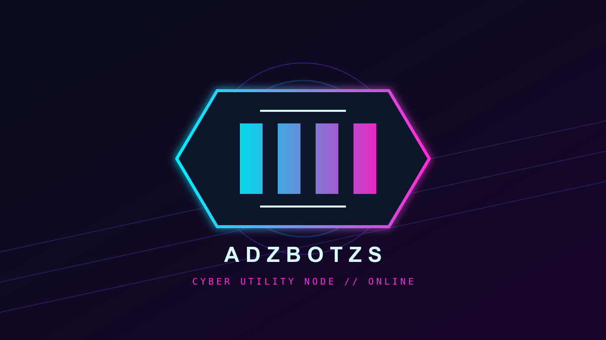

# ADZBOTZS // CYBER UTILITY NODE

<p align="center">
  
</p>

<p align="center">
  <strong>Personal WhatsApp automation node for tools, media, AI, and group control.</strong><br>
  <code>NODE.JS</code> · <code>BAILEYS</code> · <code>MYSQL</code> · <code>GEMINI</code>
</p>

> [!NOTE]
> ADZBOTZS adalah bot WhatsApp multi-device dengan antarmuka bergaya
> cyberpunk. Jalankan secara bertanggung jawab dan jangan membagikan kredensial
> server, session WhatsApp, API key, atau password database.

```text
╔════════════════════════════════════════════════════════════════╗
║  ◈ ADZBOTZS // CYBERPUNK CONTROL NODE                         ║
║  ◇ MEDIA  ◇ AI  ◇ GROUP OPS  ◇ OWNER CONSOLE                 ║
╚════════════════════════════════════════════════════════════════╝
```

## Command Matrix

Prefix dapat berupa simbol yang didukung bot, misalnya `.`, `!`, atau `#`.
Gunakan `.<command>` di bawah ini jika memakai titik.

| Command | Alias | Fungsi |
| --- | --- | --- |
| `menu` | `help` | Menampilkan daftar command |
| `owner` | `creator` | Mengirim kontak owner |
| `jokes` | - | Mengambil jokes acak |
| `sticker` | `s`, `stiker` | Mengubah gambar menjadi stiker WebP; bisa memakai gambar dengan caption atau reply gambar |
| `say <teks>` | - | Mengubah teks menjadi voice note Bahasa Indonesia |
| `toimg` | `toimage` | Mengubah sticker WebP menjadi gambar PNG |
| `tomp3` | `toaudio` | Mengubah video atau audio menjadi MP3 |
| `ai <pertanyaan>` | `ask`, `gemini` | Menjawab pertanyaan menggunakan Gemini |
| `vision [pertanyaan]` | `describe`, `lihat` | Menganalisis gambar menggunakan Gemini Vision |
| `salin` | `ocr` | Membaca teks dari gambar menggunakan OCR; bisa memakai gambar dengan caption atau reply gambar |
| `tt <link>` | `tiktok` | Mengunduh video TikTok tanpa watermark melalui API eksternal |
| `play <judul>` | `lagu` | Mencari YouTube lalu mengunduh dan mengirim audio MP3 |
| `kuis` | `tebak`, `kuislagi`, `nextquiz` | Memulai ronde kuis dari tabel `soal_kuis` selama 60 detik; bisa diulang setelah selesai |
| `rank` | `profile`, `level` | Melihat XP dan level pengguna |
| `menfess <nomor> <pesan>` | `confess` | Mengirim pesan anonim ke nomor tujuan dan membuka sesi balasan |
| `balas <pesan>` | `replymenfess` | Mengirim balasan anonim ke target menfess terakhir |
| `afk [alasan]` | - | Mengaktifkan status away dan otomatis kembali saat mengirim pesan |
| `groupinfo` | `gcinfo` | Menampilkan informasi grup |
| `tagadmin [pesan]` | `tagadmins` | Mention semua admin grup |
| `delete` | `del` | Menghapus pesan dengan reply; admin grup atau owner |
| `antilink on/off` | - | Mengaktifkan atau menonaktifkan anti-link per grup |
| `welcome on/off` | - | Mengaktifkan atau menonaktifkan sambutan member baru |
| `hidetag <teks>` | `pengumuman`, `tagall` | Mention seluruh anggota grup |
| `ping` | - | Mengecek koneksi dan latency bot; tersedia untuk semua pengguna |
| `status` | `server` | Melihat RAM, uptime, OS, dan versi Node.js; owner saja |
| `exec <command>` | `cmd`, `terminal` | Terminal server; hanya owner |

Selain command, tersedia middleware anti-link grup. Pesan berisi link grup
WhatsApp dari anggota non-admin akan dihapus dan pengirim dikeluarkan jika
bot memiliki hak admin.

### Owner Console

Command berikut tidak ditampilkan pada menu publik dan hanya muncul pada menu
owner yang terverifikasi:

```text
.status
.server
.exec <command>
```

### Group Control

Pengaturan berikut hanya dapat diubah oleh admin grup atau owner:

```text
.antilink on
.antilink off
.welcome on
.welcome off
```

## Struktur Project

```text
.
├── index.js                    # Startup Baileys dan event message
├── HandleMsg.js                # Adapter tipis ke command handler
├── features/
│   ├── commandHandler.js       # Dispatch command dan fitur bot
│   ├── gemini.js               # Integrasi Google Gen AI
│   ├── groupModeration.js      # Middleware anti-link
│   ├── groupSettings.js        # Pengaturan grup melalui MySQL
│   └── message.js              # Ekstraksi tipe dan teks pesan
├── assets/
│   └── menu-logo.png           # Logo placeholder untuk menu WhatsApp
├── config.js                   # Membaca konfigurasi dari .env
├── db.js                       # Membuat pool MySQL dari .env
└── session-baileys/            # Session login lokal, jangan di-commit
```

## Runtime Requirements

- Node.js 20 atau lebih baru
- MySQL atau MariaDB
- FFmpeg yang tersedia di `PATH`
- API key Google AI Studio untuk command AI
- WhatsApp untuk melakukan scan QR pertama kali

Untuk Ubuntu/Debian, contoh instalasi FFmpeg dan MySQL:

```bash
sudo apt update
sudo apt install ffmpeg mysql-server
```

## Boot Sequence

```bash
git clone https://github.com/adtfiry12/adzbotzs-reborn.git
cd adzbotzs-reborn
npm install
```

Buat database dan tabel yang digunakan bot:

```sql
CREATE DATABASE adzbotzs;
USE adzbotzs;

CREATE TABLE users (
  nomor_wa VARCHAR(32) PRIMARY KEY,
  xp INT NOT NULL DEFAULT 0,
  level INT NOT NULL DEFAULT 1
);

CREATE TABLE soal_kuis (
  id INT AUTO_INCREMENT PRIMARY KEY,
  soal TEXT NOT NULL,
  jawaban VARCHAR(255) NOT NULL
);
```

## Environment Configuration

Semua konfigurasi runtime berada di file `.env` pada root project. File ini
diabaikan Git dan tidak boleh dibagikan atau di-commit.

```env
OWNER_NAME=adtfiry
OWNER_NUMBER=628xxxxxxxxxx
BOT_NAME=ADZBOTZS

GEMINI_API_KEY=tempel_token_baru_di_sini
GEMINI_MODEL=gemini-flash-latest

# Opsional: path logo menu pengganti
MENU_LOGO_PATH=assets/menu-logo.png

DB_HOST=localhost
DB_USER=adtz
DB_PASSWORD=password_mysql
DB_NAME=adzbotzs
```

Bot menggunakan package resmi `@google/genai` dan alias
`gemini-flash-latest`, sehingga tidak bergantung pada nama model Flash lama
yang dapat dipensiunkan. Jangan menaruh API key langsung di `config.js`.

## Launch

```bash
npm start
```

Scan QR yang muncul di terminal melalui WhatsApp → Perangkat Tertaut.
Setelah session tersimpan, bot dapat melakukan reconnect tanpa scan ulang.

## Operations Log

- `.say` mengunduh audio TTS sebagai buffer MP3 sebelum dikirim agar voice note
  tidak kosong.
- Request Gemini memiliki timeout 45 detik.
- Respons Gemini panjang dikirim dalam beberapa pesan agar sesuai batas teks
  WhatsApp.
- Folder `session-baileys` harus disimpan di persistent disk saat deployment.
- MySQL harus dapat diakses dari mesin yang menjalankan bot.
- Downloader TikTok bergantung pada API eksternal. Downloader YouTube memakai
  layanan konversi audio eksternal dan memiliki
  batas waktu/limit layanan.
- Sesi menfess disimpan di memory selama 24 jam. Balasan target diteruskan ke
  pengirim awal, lalu pengirim dapat memakai `.balas <pesan>`.
- Command `.menu`/`.help` mengirim logo dan menu bergaya cyberpunk. Ganti
  `assets/menu-logo.png` dengan gambar sendiri, atau atur `MENU_LOGO_PATH`
  ke path file gambar lain.
- Pengaturan `.antilink` dan `.welcome` disimpan di MySQL pada tabel
  `group_settings`.

## Deployment // 24/7

Bot tidak akan tetap hidup jika laptop dimatikan. Jalankan di VPS atau worker
cloud yang prosesnya persistent. VPS dengan systemd atau PM2 biasanya paling
stabil. Platform free tier dapat sleep, membatasi resource, menghapus
filesystem, atau mengubah kebijakan, jadi tidak ada jaminan gratis selamanya.

Saat deployment:

1. Masukkan seluruh variable `.env` ke environment/secret manager server.
2. Simpan `session-baileys` pada volume persistent.
3. Pastikan MySQL tersedia dari server.
4. Jalankan bot memakai PM2 atau systemd agar otomatis restart.

Contoh PM2:

```bash
npm install --global pm2
pm2 start index.js --name adzbotzs
pm2 save
pm2 startup
```

Jangan commit `.env`, API key, password database, atau folder
`session-baileys` ke repository publik.

## Maintainer

Aditya Mukti Firmansyah (`adtfiry`)

SMK Wikrama 1 Jepara — Pengembangan Perangkat Lunak dan Gim (PPLG)
