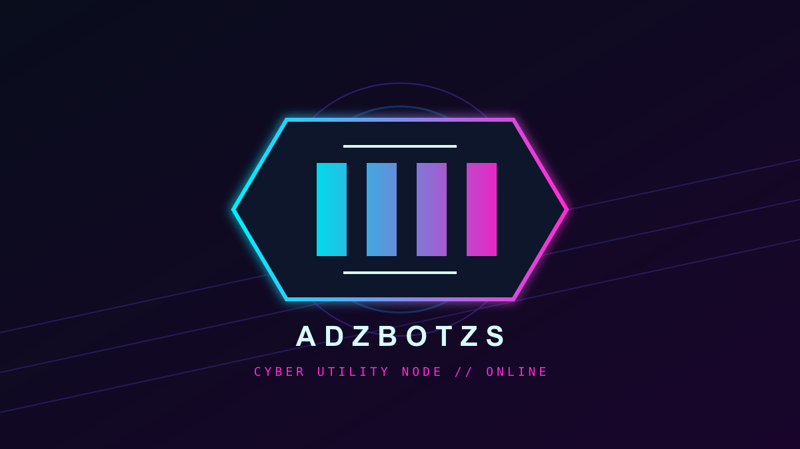

# ADZBOTZS

<p align="center">
  
</p>

Bot WhatsApp berbasis Node.js, Baileys, MySQL, Gemini, dan FFmpeg. Bisa
dijalankan dari terminal atau layanan hosting yang mendukung Node.js maupun
Docker.

## Fitur

- Menu, owner, ping, status, AFK, jokes, dan level/XP.
- Stiker, TTS, OCR, konversi media, dan downloader.
- AI Gemini untuk teks dan gambar.
- Kuis, cuaca, kalkulator, quote, dan reminder.
- Menfess dengan balasan dua arah.
- Fitur grup seperti anti-link, welcome, hidetag, rules, kick, dan tag admin.

## Kebutuhan

- Node.js 20 atau lebih baru.
- FFmpeg untuk fitur media.
- Database yang kompatibel dengan MySQL.
- API key Gemini jika ingin memakai fitur AI.

## Instalasi

```bash
git clone https://github.com/adtfiry12/adzbotzs-reborn.git
cd adzbotzs-reborn
npm install
cp .env.example .env
npm start
```

`npm install` memasang semua module dari `package.json`. Untuk deployment
production, gunakan:

```bash
npm ci --omit=dev
```

Jika `BOT_NUMBER` kosong, scan QR yang tampil di terminal. Jika diisi nomor
internasional tanpa tanda `+`, gunakan kode pairing dari log.

## Konfigurasi

Salin `.env.example` menjadi `.env`, lalu isi nilai yang diperlukan. Jangan
unggah `.env` atau API key ke repository.

| Variabel | Keterangan |
| --- | --- |
| `BOT_NAME` | Nama bot. |
| `OWNER_NAME` | Nama owner. |
| `OWNER_NUMBER` | Nomor owner dengan kode negara. |
| `BOT_NUMBER` | Nomor pairing; kosongkan untuk QR. |
| `PORT` | Port web server. |
| `GEMINI_API_KEY` | API key Gemini. |
| `GEMINI_MODEL` | Model Gemini, default `gemini-3.5-flash-lite`. |
| `DB_HOST` | Host database. |
| `DB_PORT` | Port database. |
| `DB_USER` | User database. |
| `DB_PASSWORD` | Password database. |
| `DB_NAME` | Nama database. |
| `DB_SSL` | `true` atau `false`. |
| `MENU_LOGO_PATH` | Path logo menu opsional. |

Database lokal:

```env
DB_HOST=127.0.0.1
DB_PORT=3306
DB_USER=root
DB_PASSWORD=
DB_NAME=adzbotzs
DB_SSL=false
```

Tabel bot dibuat otomatis saat database berhasil terhubung. Untuk database
cloud, gunakan host, port, user, password, dan SSL sesuai provider.

## Hosting

### Node.js

1. Hubungkan repository ke layanan hosting yang mendukung aplikasi Node.js.
2. Set environment variable dari dashboard hosting.
3. Jalankan build command `npm ci --omit=dev`.
4. Jalankan start command `npm start`.
5. Gunakan persistent storage untuk folder `session-baileys`.
6. Arahkan health check ke `/health` jika tersedia.

### Docker

```bash
docker build -t adzbotzs .
docker run --env-file .env -p 8080:8080 \
  -v adzbotzs-session:/app/session-baileys adzbotzs
```

`Dockerfile` memasang dependency Node, FFmpeg, Python, dan yt-dlp saat proses
build. Port aplikasi mengikuti nilai `PORT`.

## Command

Prefix yang didukung: `.`, `!`, dan `#`.

| Kelompok | Command |
| --- | --- |
| Menu | `menu`, `tools`, `download`, `social`, `group`, `utility`, `menfess`, `panel` |
| Umum | `owner`, `ping`, `jokes`, `afk`, `cuaca` |
| Media | `sticker`, `toimg`, `tomp3`, `say`, `salin` |
| AI | `ai`, `vision` |
| Download | `tt`, `play` |
| Sosial | `kuis`, `rank`, `quote`, `reminder` |
| Menfess | `menfess`, `balas`, `menfessinfo`, `menfessstop` |
| Grup | `groupinfo`, `tagadmin`, `hidetag`, `delete`, `kick`, `rules`, `antilink`, `welcome` |
| Utility | `calc`, `cuaca`, `quote`, `reminder` |
| Owner | `status`, `exec`, `cmdstats` |

Gunakan `.menu` untuk melihat akses cepat. Gunakan `.tools`, `.group`,
`.utility`, `.menfess`, atau `.panel` untuk membuka bagian tertentu.

## Troubleshooting

- `getaddrinfo EAI_AGAIN mysql`: ganti `DB_HOST` dengan host database yang
  benar. Host `mysql` hanya berlaku jika MySQL berada di network yang sama.
- Pairing tidak muncul: pastikan `BOT_NUMBER` hanya berisi angka.
- Login hilang setelah restart: aktifkan persistent storage untuk
  `session-baileys`.
- Fitur media gagal: pastikan FFmpeg tersedia atau rebuild image Docker.

## Lisensi

Project ini menggunakan [AGPL-3.0-only](./LICENSE).
